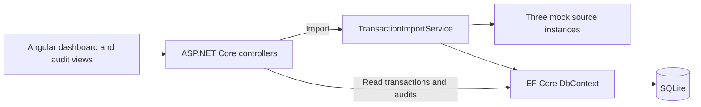

# Transactions Ingest

## Project Overview

Transactions Ingest consolidates snapshots from **Store Uptown**, **Store Downtown**, and **Online** into SQLite. A manually triggered import inserts new transactions, reconciles changes, revokes eligible missing transactions, and preserves audit history.

The Angular dashboard provides transaction summaries, filtering, sorting, imports, and refresh. Users can inspect all audit events or open a transaction's details and individual history.

## Technology Stack

| Area | Technologies / versions |
| --- | --- |
| Backend | C#, ASP.NET Core 10 controller-based Web API (`net10.0`) |
| Database | SQLite, EF Core SQLite and design-time packages 10.0.13, Code-First migrations |
| Frontend | Angular 22.2.3, CLI 22.2.4, build tooling 22.2.5, standalone components, plain CSS |
| Frontend language / HTTP | TypeScript 6.0.3, RxJS 7.8.2, Angular `HttpClient` |
| Automated tests | xUnit 2.9.3, Microsoft.NET.Test.Sdk 18.11.0, Visual Studio adapter 4.0.1 |
| Verified development tools | .NET SDK 10.0.402, ASP.NET Core runtime / `dotnet-ef` 10.0.13, Node.js 22.23.4, npm 10.9.9 |

Package versions reflect the project files and npm lockfile. SDK and Node versions are not pinned. No separate SQLite server or global Angular CLI is required.

## Architecture and Project Structure



Controllers handle HTTP requests; the import service owns validation and reconciliation. Source snapshots are independent of database entities. One configurable mock implementation represents all three sources. EF Core provides persistence directly, without a repository layer.

| Directory / file | Purpose |
| --- | --- |
| `TransactionIngest.sln` | Backend and test solution |
| `backend/TransactionIngest.Api/Controllers/` | Import, transaction, and audit APIs |
| `backend/TransactionIngest.Api/Services/` | Reconciliation and import summaries |
| `backend/TransactionIngest.Api/Sources/` | Source contract, input records, and mock scenarios |
| `backend/TransactionIngest.Api/Models/`, `Data/`, `Migrations/` | Entities, database mappings, and checked-in migration |
| `backend/TransactionIngest.Api/Program.cs`, `appsettings.json`, `Properties/` | Dependency injection, SQLite connection, and local launch profiles |
| `frontend/src/app/`, `frontend/src/styles.css` | Dashboard, details dialog, audit views, and styling |
| `frontend/proxy.conf.json` | Angular development API proxy |
| `tests/TransactionIngest.Api.Tests/` | Import-service and read-controller tests with isolated SQLite databases |

## Setup and Running

### Prerequisites and dependencies

Install Git, the **.NET 10 SDK**, and Node.js/npm. Node.js 22.23.4 and npm 10.9.9 match the verified environment; the locked Angular tooling accepts Node `^22.22.3 || ^24.15.0 || >=26.0.0`. Commands below use Bash/zsh.

```sh
git clone https://github.com/arathiashok/TransactionsIngest.git
cd TransactionsIngest
dotnet restore TransactionIngest.sln
cd frontend
npm ci
cd ..
```

Check `dotnet ef --version`. If missing, install the matching tool with `dotnet tool install --global dotnet-ef --version 10.0.13`. To update an existing global installation, use `dotnet tool update --global dotnet-ef --version 10.0.13`. Ensure the .NET tools directory is on `PATH`; no local tool manifest is supplied.

### Initialize the database

From the repository root:

```sh
cd backend/TransactionIngest.Api
dotnet ef database update --context TransactionIngestDbContext
cd ../..
```

The checked-in migration creates `backend/TransactionIngest.Api/transaction-ingest.db`. Startup does **not** apply migrations automatically; a fresh checkout needs the command above, not a newly generated initial migration. SQLite database files and journals are ignored by Git.

The default connection string is `Data Source=transaction-ingest.db;Foreign Keys=True`. Ordinary relative filenames resolve against the API's **content root**, which the documented commands set to the API directory. Absolute paths and special SQLite sources, including in-memory configurations, are preserved. Override the connection with `ConnectionStrings__TransactionIngest` when needed.

### Start both applications

Backend terminal, from the repository root:

```sh
dotnet run --project backend/TransactionIngest.Api --launch-profile http
```

Frontend terminal, from the repository root:

```sh
cd frontend
npm start
```

Open **http://localhost:4200/**. The API runs at **http://localhost:5100**. Angular forwards relative `/api/**` requests to that HTTP address through `proxy.conf.json`; both servers must run. The optional backend `https` profile binds HTTPS 7100 and HTTP 5100 and requires a development certificate. The HTTP-only profile may log an HTTPS-redirection warning; HTTP requests still work. There is no API homepage or Swagger UI.

## API Endpoints

| Endpoint | Purpose and response behavior |
| --- | --- |
| `POST /api/import` | No body. Imports all sources and returns aggregate counts plus per-source results. `200` includes completed processing with source retrieval/validation failures; `409` means another import is running; `500` means a handled database failure stopped processing. |
| `GET /api/transactions` | Transaction array ordered by source and transaction ID; `[]` when empty. Includes `sourceSystem`, `transactionId`, `cardNumber`, `locationCode`, `productName`, `amount`, `transactionTime`, and string `status`. |
| `GET /api/audits` | All audit events, newest first by `changedAtUtc`, then descending `id` to break ties. |
| `GET /api/transactions/{sourceSystem}/{transactionId}/audits` | The same audit structure, restricted to the composite identity. Returns `404` for a nonexistent transaction, or `[]` for an existing transaction without events. URL-encode source names. |

Import results include `referenceTimeUtc`, `isBusy`, `stoppedOnDatabaseFailure`, five transaction counts (`inserted`, `updated`, `revoked`, `reactivated`, `unchanged`), and `sources` with each source's status, counts, and optional error. Source statuses are `Completed`, `SkippedIncomplete`, `SkippedInvalid`, `RetrievalFailed`, `DatabaseFailed`, and `NotProcessed`.

Both audit APIs return `id`, `sourceSystem`, `transactionId`, `action`, `fieldName`, `oldValue`, `newValue`, and `changedAtUtc`. Actions and transaction statuses are readable strings. Read queries use `AsNoTracking` and do not expose EF navigation properties. Card values are empty for non-card payments or masked as `***4444`; unsafe legacy values are suppressed. The transaction API returns amounts in currency units as exact invariant decimal strings with two decimal places, such as `"29.99"`, rather than JSON numbers or stored cents.

```sh
curl -X POST http://localhost:5100/api/import
curl http://localhost:5100/api/transactions
curl http://localhost:5100/api/audits
curl 'http://localhost:5100/api/transactions/Store%20Uptown/101/audits'
```

## Reconciliation and Auditing

Transactions are identified by **`(SourceSystem, TransactionId)`**. The same ID in different sources represents independent transactions; identity fields never change.

| Condition | Transaction and audit behavior |
| --- | --- |
| New identity | Insert as `Active`; record one `Created` event, without separate initial-field events. |
| Changed business fields | Compare card number, location, product, amount, and transaction time. Update only changed fields; record one `Updated` event per changed field. |
| Identical incoming values | No transaction changes or additional audits. |
| Eligible missing Active transaction | Mark `Revoked`; record the Status old/new values. |
| Revoked transaction reappears | Restore `Active`; record `Reactivated` for Status and any accompanying business-field changes. Count the transaction as reactivated. |

Revocation requires a **successful, complete snapshot** and uses:

```text
referenceTimeUtc - 24 hours <= TransactionTime < referenceTimeUtc
```

Exactly 24 hours old qualifies; older transactions, future transactions, and transactions exactly at the reference time do not. Missing transactions outside the window retain their status. Delayed incoming transactions are accepted even when older than 24 hours. Optional finalization is not implemented.

The entire source snapshot is validated before database changes: required values, lengths, duplicate IDs, UTC timestamps, masked/empty card numbers, and exact `decimal(18,2)` amounts. Incomplete snapshots are skipped entirely; invalid snapshots and retrieval failures also leave that source unchanged while other sources continue. A successful complete empty snapshot is authoritative.

Sources run sequentially. Each source's transaction changes and audit events are saved atomically in one `SaveChangesAsync`; database failure stops later sources but does not undo earlier committed sources. Cancellation propagates. One singleton synchronization gate rejects overlapping imports and prevents scenario changes during an import, within this application process.

Audit history is preserved in `TransactionAudits`, using a generated ID and a restricted composite foreign key to the transaction. Old/new values use invariant formatting, with two decimal places for amounts and UTC round-trip timestamps. Creation has null field/value details. One UTC reference time is captured per import. Repeating identical snapshots produces no extra audits when time-based eligibility is unchanged; a moving clock can change eligibility.

## Frontend Features

- Summary cards show total, Active, and Revoked counts across all loaded transactions.
- Source/status filters, time/amount sorting, and a matching-record count operate client-side.
- **Import Transactions** displays the five import counts and source issues, then refreshes data. **Refresh** reloads transactions.
- **Show Audit History** retrieves all persisted events; **Back to Transactions** returns to the dashboard.
- Selecting a transaction row opens its details, including masked card information, with only that transaction's audit history underneath. A close button and Escape dismiss the dialog.
- Views include loading, empty, error, and Retry states. Relevant controls are disabled during requests. Tables support smaller screens through horizontal scrolling; amounts use two decimals and times are displayed in UTC.

## Manual Testing and Mock Scenarios

### Scenarios and Development settings

All three mock sources share a singleton scenario state. Selection is explicit: fetching/importing never advances the scenario.

| Scenario | Snapshot per source |
| --- | --- |
| `Baseline` | Complete: IDs 101 and 102. |
| `Changes` | Complete: updated amount for 101, new 103, delayed 104; 102 missing. |
| `Reactivation` | Complete: updated 101 plus 102, 103, and 104. |
| `Incomplete` | Original 101 only, with `IsComplete = false`; the entire snapshot is skipped. |
| `Failure` | Simulated retrieval exception; existing records remain unchanged. |

In **Development only**, `MockSources__Scenario` selects a case-insensitive scenario name and `MockSources__ReferenceTimeUtc` fixes the import clock to a UTC timestamp ending in `Z`. Invalid values stop startup. Without these settings, the defaults are **Baseline and the real system clock**; outside Development the overrides are ignored. There is no scenario-switching API or UI: restart the backend to change scenarios.

### Initialize a separate database and fixed clock

Complete dependency setup first. Stop the existing backend to free port 5100. From the repository root, in the backend terminal:

```sh
export DOTNET_ENVIRONMENT=Development
export ConnectionStrings__TransactionIngest='Data Source=transaction-ingest-lifecycle.db;Foreign Keys=True'
export MockSources__ReferenceTimeUtc='2026-10-25T12:00:00Z'
export MockSources__Scenario=Baseline
cd backend/TransactionIngest.Api
dotnet ef database update --context TransactionIngestDbContext
cd ../..
```

This initializes **`backend/TransactionIngest.Api/transaction-ingest-lifecycle.db`**, leaving the normal development database untouched. Use an unused filename if that file already contains data: migrations do not empty an existing database. Retain this same database, terminal, and clock between scenarios; repeat the exports if opening another terminal.

The fixtures use `2026-10-25T12:00:00Z`. Fixing the import clock makes the revocation window `[2026-10-24T12:00:00Z, 2026-10-25T12:00:00Z)`, regardless of the evaluator's actual date. Without this override the fixed fixtures may fall outside the window.

### Run the lifecycle

Keep Angular running as described in Setup. Run **one backend command at a time**, from the repository root in the configured terminal; stop with **Ctrl+C** before starting the next scenario:

```sh
# Import twice: initial creation, then idempotency.
MockSources__Scenario=Baseline dotnet run --project backend/TransactionIngest.Api --launch-profile http

# Import twice: changes/revocation, then idempotency.
MockSources__Scenario=Changes dotnet run --project backend/TransactionIngest.Api --launch-profile http

# Import once: restore transaction 102 in each source.
MockSources__Scenario=Reactivation dotnet run --project backend/TransactionIngest.Api --launch-profile http

# Import once: skip incomplete snapshots.
MockSources__Scenario=Incomplete dotnet run --project backend/TransactionIngest.Api --launch-profile http

# Import once: report source retrieval failures without losing data.
MockSources__Scenario=Failure dotnet run --project backend/TransactionIngest.Api --launch-profile http
```

After each startup, click **Import Transactions** at `http://localhost:4200/` and inspect the summary and refreshed table. Starting the API alone does not import. The response's reference time should be `2026-10-25T12:00:00Z`. Use Refresh after changing databases to discard previously loaded results.

Expected results below assume an **empty isolated database and this exact sequence**. Counts are **Inserted / Updated / Revoked / Reactivated / Unchanged**, across all sources; stored rows and audits are cumulative.

| Import | Five counts | Stored rows | Active / Revoked | New audit actions | Total audits |
| --- | --- | ---: | --- | --- | ---: |
| Baseline | 6 / 0 / 0 / 0 / 0 | 6 | 6 / 0 | 6 Created | 6 |
| Baseline repeated | 0 / 0 / 0 / 0 / 6 | 6 | 6 / 0 | None | 6 |
| Changes | 6 / 3 / 3 / 0 / 0 | 12 | 9 / 3 | 6 Created, 3 Updated, 3 Revoked | 18 |
| Changes repeated | 0 / 0 / 0 / 0 / 9 | 12 | 9 / 3 | None | 18 |
| Reactivation | 0 / 0 / 0 / 3 / 9 | 12 | 12 / 0 | 3 Reactivated | 21 |
| Incomplete | 0 / 0 / 0 / 0 / 0 | 12 | 12 / 0 | None; all sources skipped | 21 |
| Failure | 0 / 0 / 0 / 0 / 0 | 12 | 12 / 0 | None; all retrievals fail | 21 |
| Baseline again (check below) | 0 / 3 / 3 / 0 / 3 | 12 | 9 / 3 | 3 Updated, 3 Revoked | 27 |

Changes adjusts ID 101 amounts: Uptown Wireless Mouse **29.99 → 34.99**, Downtown USB-C Docking Station **129.99 → 119.99**, Online Gaming Headset **69.99 → 59.99**. ID 102 is eligible for revocation at `2026-10-25T11:00:00Z`. ID 104 is accepted despite arriving 30 hours late. Repeating Reactivation yields 12 unchanged and no new audits. Starting Changes/Reactivation on an empty database inserts rows instead of demonstrating the intended transitions.

**Check the older-missing rule:** after the sequence, restart with the Baseline command and import once more. Missing 104 stays Active because its time is `2026-10-24T06:00:00Z` (30 hours old). Missing 103 is revoked because its time is `2026-10-25T11:30:00Z`. ID 101 also reverts to Baseline prices, accounting for the three additional updates in the final table row.

**Verify both audit views:** Baseline events should appear in Show Audit History and in each transaction's details. Changes adds Amount old/new values and Status revocations; Reactivation adds Status restoration events. Check all three sources in the global view and select the same ID in different sources to confirm isolated histories. Repeat imports to confirm audit totals stay unchanged, then verify Back/Close navigation, filters, sorting, Refresh, and Import still work. Temporarily stopping the API also allows checking error/Retry states.

### Inspect SQLite directly

Use a SQLite viewer, or optionally open the test database from the repository root with:

```sh
sqlite3 backend/TransactionIngest.Api/transaction-ingest-lifecycle.db
```

```sql
-- Persisted identities, times, statuses, and integer-cent amounts.
SELECT SourceSystem, TransactionId, Amount AS AmountInCents, TransactionTime, Status
FROM Transactions ORDER BY SourceSystem, TransactionId;

-- Individual field changes, in the same order as the audit API.
SELECT Id, SourceSystem, TransactionId, Action, FieldName, OldValue, NewValue, ChangedAtUtc
FROM TransactionAudits
WHERE SourceSystem = 'Store Uptown' AND TransactionId = 101
ORDER BY ChangedAtUtc DESC, Id DESC;

-- Compare counts before/after repeat imports to verify no additional audit events.
SELECT Action, COUNT(*) AS EventCount
FROM TransactionAudits GROUP BY Action ORDER BY Action;
```

Through Reactivation/Incomplete/Failure, expect **12 Created, 3 Updated, 3 Revoked, 3 Reactivated**. After the final Baseline check, expect **12 Created, 6 Updated, 6 Revoked, 3 Reactivated**. The fixed clock gives events matching timestamps, so audit ID provides the ordering tie-breaker.

To return to normal operation, stop the backend, clear overrides, and restart; Angular can remain running:

```sh
unset MockSources__Scenario MockSources__ReferenceTimeUtc
unset ConnectionStrings__TransactionIngest DOTNET_ENVIRONMENT
dotnet run --project backend/TransactionIngest.Api --launch-profile http
```

This restores the original development database, Baseline, and the system clock without deleting the isolated database. Refresh Angular after switching back.

## Automated Testing

From the repository root:

```sh
dotnet build TransactionIngest.sln
dotnet test TransactionIngest.sln
cd frontend
npm test
npm run build
cd ..
```

The latest verification passed **67 backend tests and 13 frontend money tests**, the solution build, and the Angular production build. Backend tests use isolated in-memory SQLite databases with the real migrations and a controlled clock. Coverage includes reconciliation, idempotency, field-level audits, exact revocation boundaries, delayed records, reactivation, validation/source failures, source isolation, atomic rollback, cancellation, concurrency, and global/individual audit retrieval, ordering, and masked-card responses.

Controller tests invoke actions directly. Frontend money tests run with `npm test` from `frontend/`, using Node's built-in runner to check exact formatting and amount sorting, including values at the monetary limits. There is no automated hosted HTTP/browser suite. The manual workflow above exercises integration. Angular builds to `frontend/dist/transaction-ingest/browser/`.

## Design Decisions and Limitations

- **Exact money:** C# `decimal` values are stored as integer cents, enforcing `decimal(18,2)` range and precision without rounding. Zero and negative amounts/IDs are allowed. The API returns exact decimal strings; the frontend preserves the full supported range through string formatting and `bigint`-based integer-cent comparisons for amount sorting.
- **UTC and validation:** Imports require UTC transaction times; database conversions preserve UTC on reads/writes. Source/location values are limited to 19 characters, card input to empty or `***` plus four digits. Product names allow 100 characters because the exercise's sample conflicts with its stated short-string limit.
- **Small, explicit architecture:** Two domain entities, direct DbContext use, per-source atomic saves, and a process-local concurrency gate. There is no distributed import lock or cross-source all-or-nothing transaction.
- **Mocked/manual operation:** External APIs are simulated. No background scheduler, scenario-switching endpoint, or real source integration is included.
- **Optional scope omitted:** No finalization/immutable older transactions, pagination, authentication, or transaction editing. Filters and sorts operate on the complete loaded dataset.
- **Hosting:** The Angular proxy is development-only. The API does not host the production frontend build; production static hosting, API forwarding, and certificate setup are outside this submission's setup instructions.

## AI Assistance

ChatGPT and Codex were used during the development of this application for design discussions, implementation, testing, code review, and documentation. The significant prompts, technical decisions, and revisions to AI-generated code are documented in [AI_DISCLOSURE.md](AI_DISCLOSURE.md).